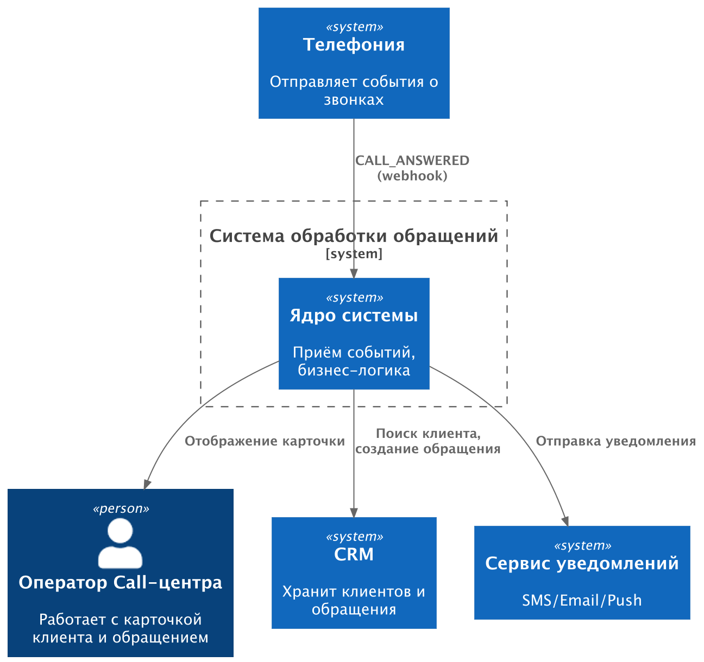

# 05. Моделирование

**Проект:** Автоматизация обработки входящих обращений Call-центра  
**Тип проекта:** Самостоятельный учебный кейс по системному анализу  
**Статус документа:** Учебная версия

## 1. Цель моделирования

Моделирование используется для представления границ системы, взаимодействия с внешними системами и правил реакции на события.

В рамках кейса используются три артефакта:

- контекстная диаграмма;
- таблица Event–Response;
- CRUD-матрица.

Модели построены автором самостоятельно на основе допущений учебного сценария.

## 2. Контекстная диаграмма

### 2.1. Назначение

Контекстная диаграмма показывает систему автоматизации обработки входящих обращений, её основного пользователя и внешние системы, с которыми она взаимодействует.

На диаграмме представлены:

- оператор Call-центра;
- телефония;
- CRM;
- внешний сервис уведомлений;
- система автоматизации обработки входящих обращений.

### 2.2. Диаграмма PlantUML

### 2.3. Пояснение к диаграмме

Телефония передаёт событие о входящем звонке в систему автоматизации. Система выполняет необходимую обработку и обращается к CRM для поиска клиента и работы с обращениями.

После обработки система инициирует отправку уведомления через внешний сервис и предоставляет оператору информацию о клиенте и обращении.

CRM и сервис уведомлений являются внешними системами. В рамках текущего сценария CRM выступает системой хранения клиентских данных и обращений.

**Ограничение модели:** способ отображения информации оператору и конкретные API-контракты внешних систем в учебном кейсе не специфицированы.

## 3. Таблица Event–Response

### 3.1. Назначение

Таблица Event–Response описывает события, которые возникают при обработке входящих звонков, и соответствующие реакции системы.

Она позволяет зафиксировать поведение системы в основном потоке и при возникновении ошибок или нестандартных ситуаций.

### 3.2. Реестр событий и реакций

| ID | Событие или условие | Источник | Реакция системы | Результат |
|---|---|---|---|---|
| EV-01 | Получено событие `CALL_ANSWERED` с корректным номером | Телефония | Система ищет клиента в CRM, проверяет наличие открытого обращения, при необходимости создаёт новое обращение, определяет ответственного и инициирует отправку уведомления | Информация об обращении доступна оператору |
| EV-02 | Получено событие с некорректным номером | Телефония | Система фиксирует ошибку и отображает оператору предупреждение. Обращение не создаётся | Ошибочное событие не приводит к созданию обращения |
| EV-03 | Клиент не найден в CRM | CRM | Система создаёт обращение без привязки к клиенту и присваивает статус «Требует уточнения клиента» | Оператор получает информацию о необходимости уточнить данные |
| EV-04 | Поступил повторный звонок в течение 24 часов при наличии открытого обращения | Телефония, CRM | Система связывает новый звонок с существующим обращением и не создаёт новое | Дублирование обращений по заданному бизнес-правилу предотвращается |
| EV-05 | CRM недоступна | CRM | Система повторяет запрос до трёх раз с экспоненциальной задержкой. После неудачных попыток фиксирует необходимость ручной обработки | Событие не считается успешно обработанным |
| EV-06 | Нет подходящего активного оператора | Система | Система назначает доступного дежурного оператора. Если он отсутствует, обращение помечается как требующее ручного назначения | Зафиксирован ответственный либо необходимость ручного назначения |
| EV-07 | Сервис уведомлений недоступен | Сервис уведомлений | Система сохраняет уведомление в очереди и повторяет отправку по установленному расписанию | Обращение сохраняется, уведомление ожидает повторной отправки |

### 3.3. Примечания

- EV-01 описывает основной поток обработки входящего звонка.
- EV-02–EV-07 фиксируют альтернативные и исключительные ситуации.
- Событие EV-04 относится к новому входящему звонку от того же номера в пределах установленного периода, а не к повторной доставке одного webhook-события.
- Обработка недоступности CRM и сервиса уведомлений согласована с поведением, описанным в Use Case.

## 4. CRUD-матрица

### 4.1. Назначение

CRUD-матрица показывает, какие операции выполняются над основными сущностями в рамках сценария UC-01 «Обработать входящий звонок».

Обозначения:

- **C — Create:** создание;
- **R — Read:** чтение;
- **U — Update:** изменение;
- **D — Delete:** удаление.

Матрица описывает логические операции системы, в том числе выполняемые через API внешних систем. Она не означает, что все сущности обязательно хранятся в собственной базе данных сервиса.

### 4.2. Матрица операций

| Сущность | UC-01. Обработать входящий звонок | Источник или владелец данных |
|---|---|---|
| Обращение (Ticket) | C, R, U | CRM |
| Клиент (Client) | R | CRM |
| Уведомление (Notification) | C, R, U | Учёт отправки и повторной отправки уведомлений |
| Оператор (Operator) | R | Источник справочника операторов требует уточнения |

### 4.3. Пояснение к матрице

**Обращение.** Создаётся в CRM при отсутствии подходящего открытого обращения. Система также проверяет наличие обращения и выполняет необходимые изменения в рамках согласованного сценария.

**Клиент.** Используется как источник данных при поиске в CRM. Создание и изменение карточки клиента не входят в текущий сценарий.

**Уведомление.** Система инициирует отправку уведомления и должна иметь возможность учитывать его состояние, включая постановку в очередь и повторную отправку. Конкретная структура хранения и взаимодействие с внешним сервисом будут уточнены при проработке требований к данным.

**Оператор.** Система читает информацию, необходимую для выбора подходящего или дежурного оператора. Конкретный источник справочника операторов и его атрибуты в текущем кейсе пока не определены.

Операция удаления не предусмотрена для рассматриваемого сценария.

## 5. Результаты этапа

В рамках этапа подготовлены:

- контекстная диаграмма с границами системы и внешними интеграциями;
- таблица событий и реакций системы;
- CRUD-матрица основных сущностей;
- пояснения к взаимодействию с внешними системами и обработке нестандартных ситуаций.

Модели используются на следующем этапе для уточнения сущностей, атрибутов, связей и ограничений целостности данных.

